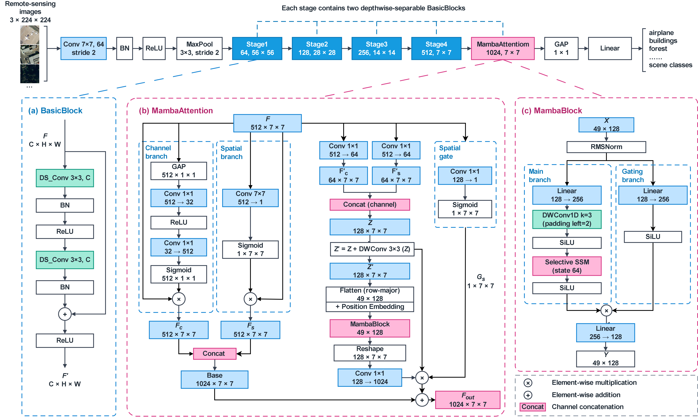

# LRMNet

PyTorch implementation of **LRMNet: Lightweight Intra-Image Region Relation Modeling for Remote Sensing Scene Classification**, accepted for publication in **IEEE Signal Processing Letters**.

LRMNet combines a depthwise-separable residual backbone with parallel channel/spatial recalibration, compressed spatial-token processing, and outer spatially gated residual fusion. The paper configuration uses a ResNet-18 topology and a contextual feature width of 128.



## Installation

```bash
git clone https://github.com/zzyyuus/LRM.git
cd LRM
pip install -r requirements.txt
```

## Datasets

Experiments use **SIRI-WHU** and **UC Merced Land Use**. Prepare the dataset images locally. Each data root should contain the original class folders. The dataset partitions are provided in splits/.

## Training

```bash
python train.py --config configs/UCMerced.json --data-root /path/to/UCMerced_LandUse/Images --output runs/UCMerced_s42 --seed 42 --device cuda
python train.py --config configs/SIRI-WHU.json --data-root /path/to/12class_tif --output runs/SIRI_s42 --seed 42 --device cuda
```

Replace the data paths with your local directories. For three-seed experiments, repeat with seeds 43 and 44 and use a separate output directory for each run.

## Testing and Evaluation

Evaluate the checkpoint saved during training:

```bash
python evaluate.py --config configs/UCMerced.json --checkpoint runs/UCMerced_s42/best_ema.pt --data-root /path/to/UCMerced_LandUse/Images --device cuda
python evaluate.py --config configs/SIRI-WHU.json --checkpoint runs/SIRI_s42/best_ema.pt --data-root /path/to/12class_tif --device cuda
```

Evaluation reports overall accuracy, macro-F1, Kappa, and the confusion matrix. Accuracy and macro-F1 are returned as fractions.

## Citation

LRMNet: Lightweight Intra-Image Region Relation Modeling for Remote Sensing Scene Classification. IEEE Signal Processing Letters, accepted for publication.
